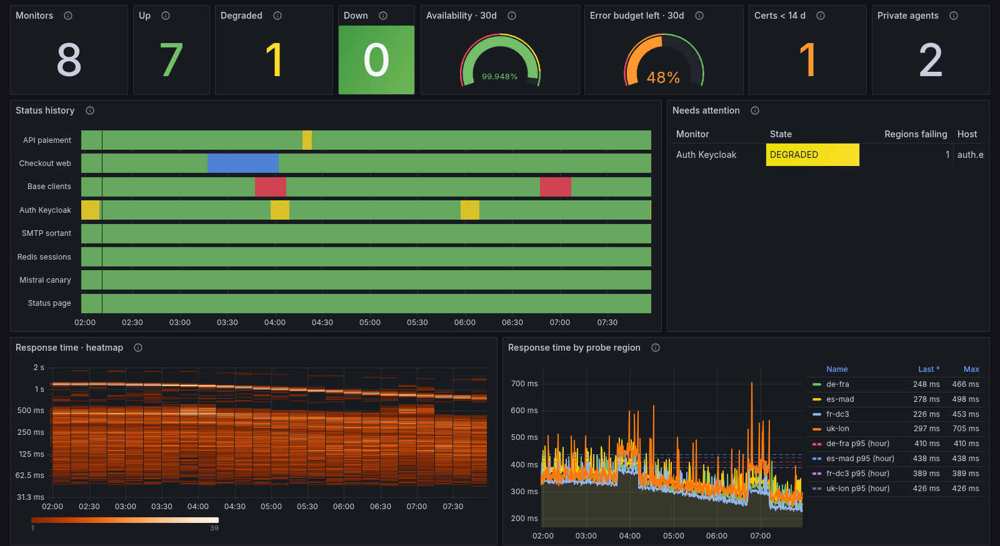
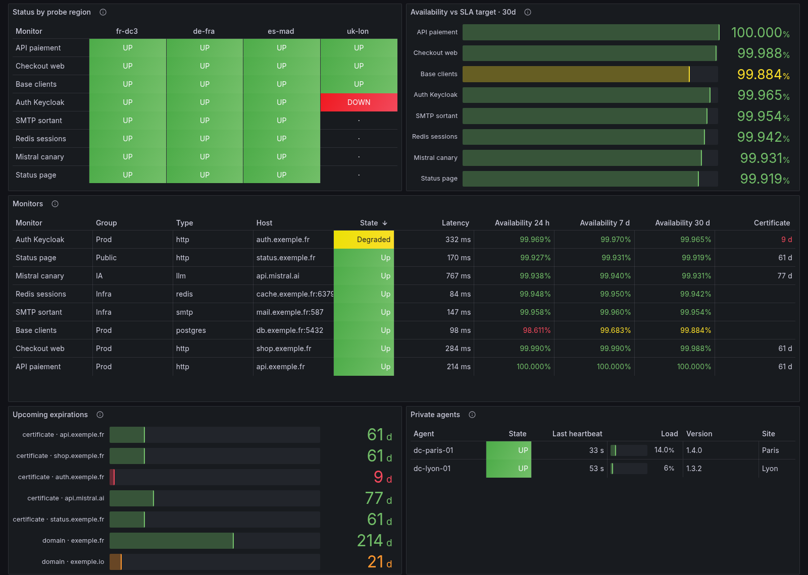

# OKStatus for Grafana and Prometheus

The Grafana dashboard and the Prometheus alerting rules for the
[OKStatus](https://okstatus.eu) Prometheus export: every monitor of your
organization in your own Prometheus, from
`https://api.okstatus.eu/api/v1/metrics`.



| Folder                         | Content                                                  |
| ------------------------------ | -------------------------------------------------------- |
| [`dashboards/`](dashboards/)   | **OKStatus · Uptime overview**, 19 panels, Grafana 10.4+ |
| [`alerts/`](alerts/)           | 10 alerting rules and their `promtool` unit tests        |
| [`screenshots/`](screenshots/) | the dashboard on six hours of data                       |

Full guide (setup, metric reference, limits):
https://okstatus.eu/docs/integrations/prometheus/

## Requirements

- An OKStatus organization on the **Pro** plan or above.
- A **Metrics** API key (Settings → API keys). It reads the export and
  nothing else: if it leaks, it can't read the rest of the API or change
  anything.
- Prometheus 2.x/3.x, Grafana Alloy, VictoriaMetrics, Mimir or any store that
  reads the Prometheus format.

## 1. Scrape the export

Save the key in a file Prometheus can read, never in `prometheus.yml`:

```bash
umask 077
printf '%s' 'oks_live_…' > /etc/prometheus/okstatus.token
```

```yaml
scrape_configs:
  - job_name: okstatus
    scrape_interval: 30s
    scheme: https
    metrics_path: /api/v1/metrics
    authorization:
      credentials_file: /etc/prometheus/okstatus.token
    static_configs:
      - targets: [api.okstatus.eu]
```

<details>
<summary>Grafana Alloy</summary>

```hcl
prometheus.scrape "okstatus" {
  targets         = [{ "__address__" = "api.okstatus.eu" }]
  scheme          = "https"
  metrics_path    = "/api/v1/metrics"
  scrape_interval = "30s"
  authorization {
    credentials_file = "/etc/alloy/okstatus.token"
  }
  forward_to = [prometheus.remote_write.default.receiver]
}
```

</details>

<details>
<summary>Prometheus Operator (kube-prometheus-stack)</summary>

```yaml
apiVersion: monitoring.coreos.com/v1alpha1
kind: ScrapeConfig
metadata:
  name: okstatus
spec:
  scheme: HTTPS
  metricsPath: /api/v1/metrics
  scrapeInterval: 30s
  authorization:
    type: Bearer
    credentials:
      name: okstatus-token # Secret with the key under "token"
      key: token
  staticConfigs:
    - targets: [api.okstatus.eu]
```

The operator only picks up `ScrapeConfig` objects its `scrapeConfigSelector`
matches: with kube-prometheus-stack, set
`prometheus.prometheusSpec.scrapeConfigSelectorNilUsesHelmValues: false`.

</details>

The answer is computed once and cached 15 seconds per organization, so 30 s
or 60 s is enough. Each organization can scrape 60 times a minute.

## 2. Import the dashboard

In Grafana, **Dashboards → New → Import**, type the ID **25909**
([grafana.com](https://grafana.com/grafana/dashboards/25909/)) and click
**Load**. Without internet access from Grafana, upload
[`dashboards/okstatus-uptime-overview.json`](dashboards/okstatus-uptime-overview.json)
and pick your Prometheus data source.

- Headline figures: monitors up, degraded and down, mean availability, error
  budget left against your SLA target.
- Status history of every monitor, under the multi-region majority rule.
- Response time heatmap, and response times per probe region with the hourly
  p95.
- Status of every monitor from every probe region.
- Availability against the SLA target, a table of every monitor, upcoming
  certificate and domain expirations, private agents.
- Collapsed rows for AI model monitors and per-monitor SLA detail.

Tables only keep OKStatus labels, so the external labels a Thanos, Mimir or
federated setup adds (`cluster`, `region`, replica…) don't show up as
columns.



## 3. Load the alerting rules

```yaml
rule_files:
  - /etc/prometheus/rules/okstatus-alerts.yml
```

With the Prometheus Operator, wrap the file's `groups:` in a
`PrometheusRule`. In `OKStatusExportUnreachable`, set `job` to the job name
of your scrape config.

| Alert                                          | When                                                                      |
| ---------------------------------------------- | ------------------------------------------------------------------------- |
| `OKStatusMonitorDown`                          | a monitor is down (majority of its probe regions)                         |
| `OKStatusMonitorDegraded`                      | degraded for 10 minutes                                                   |
| `OKStatusProbeRegionDown`                      | one probe region fails for 15 minutes while the monitor isn't down        |
| `OKStatusCertificateExpiresSoon` / `…VerySoon` | a TLS certificate expires within 14 days / 3 days                         |
| `OKStatusDomainExpiresSoon`                    | a domain expires within 30 days                                           |
| `OKStatusSlaTargetMissed`                      | 30-day availability below the monitor's SLA target, or the organization's |
| `OKStatusMonitorStale`                         | no check for three intervals, outside a pause or a maintenance            |
| `OKStatusPrivateAgentDown`                     | a private agent stopped sending heartbeats                                |
| `OKStatusExportUnreachable`                    | Prometheus can't scrape the export (key, plan, network)                   |

Run the unit tests yourself:

```bash
cd alerts && promtool test rules okstatus-alerts.test.yml
```

OKStatus already alerts on its own channels (Slack, Teams, SMS, PagerDuty…):
these rules are for teams that want every alert to go through their
Alertmanager. Use one or the other per monitor, not both.

## Metrics

Every series about a monitor carries `monitor_id`, `monitor_name`,
`monitor_type`, `monitor_host` and `monitor_group`. `monitor_host` is the
host (and port) only, never the URL, which can contain secrets. The probe
region is `probe_region`, so it never collides with a `region` external
label. Reference of the 25 metric families:
https://okstatus.eu/docs/integrations/prometheus/#metrics-reference

## License

Apache 2.0. The dashboard and rules are maintained with the OKStatus
export; issues and pull requests are welcome.
